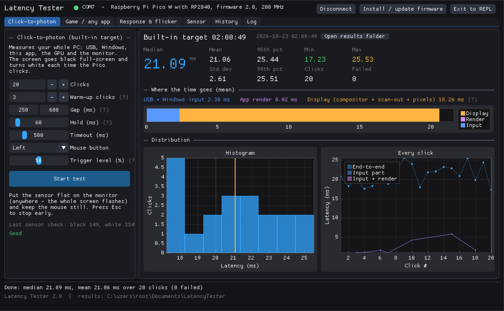
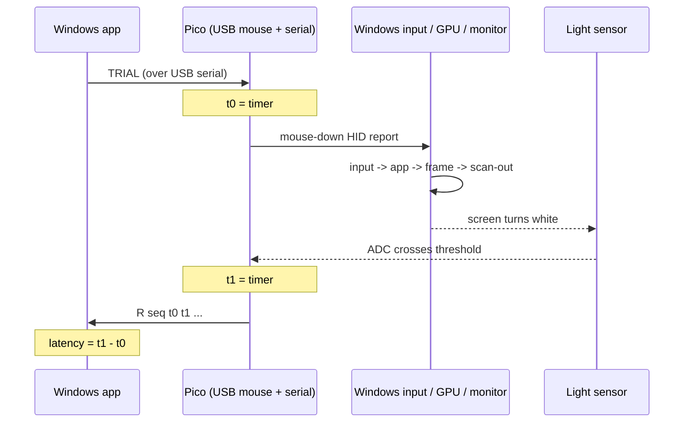
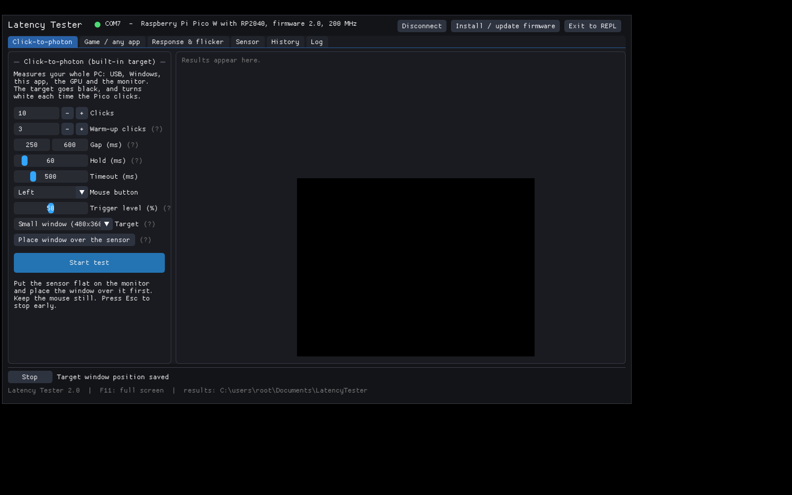
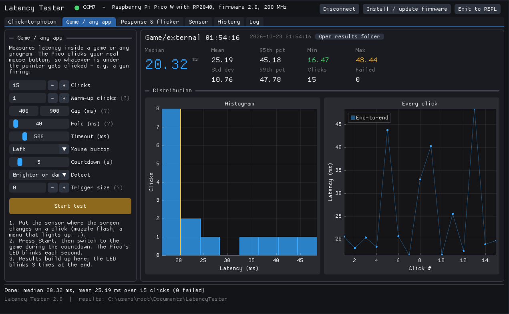
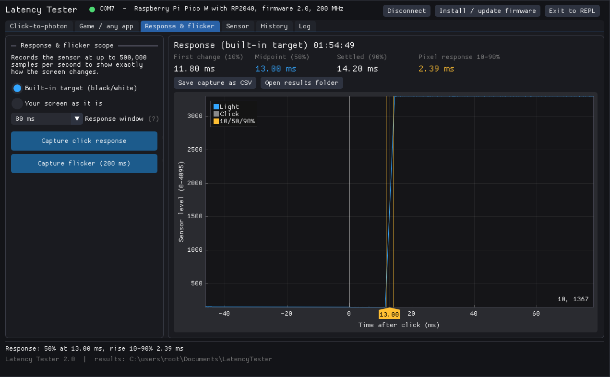
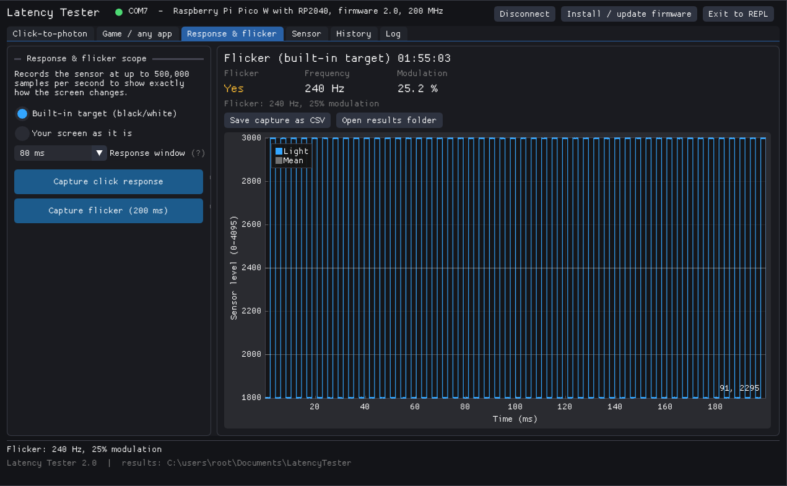
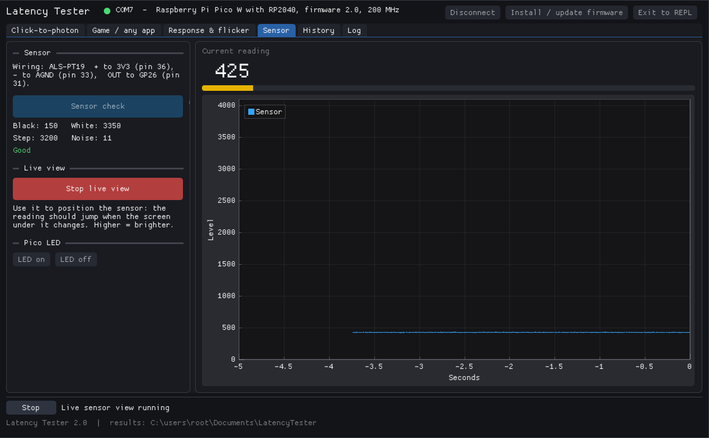
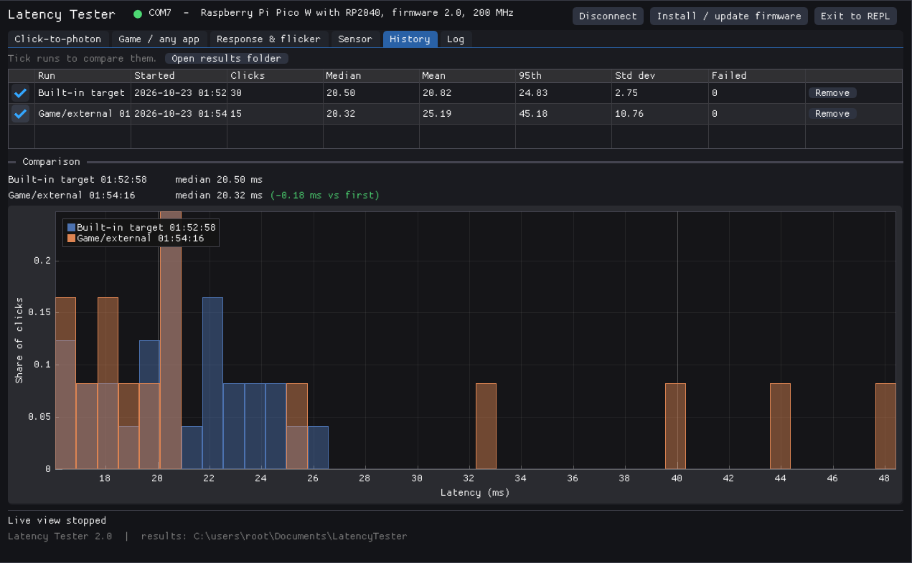

# Pico Latency Tester

**Measure click-to-photon latency on your PC with a Raspberry Pi Pico and a light sensor.**

A Pico pretends to be a USB mouse, clicks, and times how long it takes for the
screen to change, with microsecond resolution. A native Windows app runs the
tests, splits the delay into USB/Windows, app and display parts, and keeps the
results.



> **Two versions, two repositories:**
> - **This repository - PC app version (v2.1):** a Pico / Pico W + sensor, driven by a
>   Windows app with a built-in target, latency breakdown, scope and history.
> - **[Pico-Latency-Tester-LCD](https://github.com/Casio-Byte/Pico-Latency-Tester-LCD) - LCD version (v3.1):**
>   no app. A Waveshare RP2040-LCD-0.96 with its own screen, the sensor and one
>   button, in a 3D-printed case.
>
> **Status: tested and working on real hardware.** It was also tested end to
> end against a simulated Pico during development (see [How it was tested](#how-it-was-tested)).
> Issues and results welcome.

---

## Contents

- [What it measures](#what-it-measures)
- [How it works](#how-it-works)
- [Hardware](#hardware)
- [Quick start](#quick-start)
- [The tests](#the-tests)
- [Design notes](#design-notes)
- [Accuracy and limits](#accuracy-and-limits)
- [How it was tested](#how-it-was-tested)
- [Building from source](#building-from-source)
- [Project layout](#project-layout)
- [Troubleshooting](#troubleshooting)
- [Licence](#licence)

---

## What it measures

**Click-to-photon latency** is the time from a mouse button being pressed to the
screen visibly reacting. It is the sum of everything in between:

```
mouse USB report -> USB polling -> Windows input stack -> application -> GPU
-> compositor / flip -> monitor scan-out -> pixel response -> light
```

Software tools can only time the parts they can see. This tester times the
whole chain from outside: the Pico sends the click, and the same Pico watches
the screen with a light sensor, so both ends are on one microsecond clock.

## How it works



- The Pico is a **composite USB device**: a mouse (to click) and a serial port
  (to talk to the app). No drivers needed.
- The time-critical loops on the Pico are native code (MicroPython `viper`)
  reading hardware registers directly: the 1 MHz timer and an ADC running
  continuously at 500,000 samples per second.
- The app shows a **built-in target** (black, turning white on click) and can
  also measure **any game or program**.

## Hardware

| Part | Notes |
|---|---|
| Raspberry Pi Pico or Pico W (RP2040) | The Pico 2 (RP2350) is not supported - the firmware reads RP2040 registers directly |
| [Adafruit ALS-PT19](https://www.adafruit.com/product/2748) analog light sensor | Visible-light phototransistor; fast, rejects infrared. Load resistor is on the board |
| USB cable | The Pico's USB is the only connection to the PC |

Wiring (three wires):

| ALS-PT19 | Pico pin |
|---|---|
| `+`   | 3V3 (pin 36) |
| `-`   | AGND (pin 33) |
| `OUT` | GP26 / ADC0 (pin 31) |

The Pico's own LED shows its state:

| LED | Meaning |
|---|---|
| Slow blink | Waiting for the app |
| Off | App connected, idle |
| On | Click being held |
| Fast flicker for 2 s after plug-in | Press BOOTSEL now for maintenance mode |

## Quick start

1. **MicroPython** - hold BOOTSEL, plug the Pico in, and install MicroPython
   from Thonny (*Install MicroPython...* -> the Pico or Pico W variant). Close Thonny.
2. **App** - download `LatencyTester.exe` from the
   [Releases](../../releases) page and run it (Windows 10/11, no installer;
   SmartScreen: *More info* -> *Run anyway*).
3. **Firmware** - click **Install / update firmware**. The app uploads the
   firmware and the USB mouse library to the Pico through MicroPython's raw
   REPL, restarts it and reconnects. The status dot turns green.
4. **Test** - put the sensor flat on the screen, press **Start test**, and
   leave the mouse alone.

Results are saved as CSV files in `Documents\LatencyTester`.

## The tests

### Click-to-photon (built-in target)

The app shows a black target that turns white the instant its mouse-down
message arrives. Each run reports median, mean, 95th/99th percentile, min, max
and standard deviation, plus a histogram and a per-click plot.

It also splits the time into three parts:

| Part | From -> to |
|---|---|
| **USB + Windows input** | Pico sends the click -> app receives the mouse message |
| **App render** | Message received -> white frame presented |
| **Display** | Frame presented -> sensor sees the change (compositor, scan-out, pixel response) |

The target can be **full screen** or a **small / large window**. A window goes
through the Windows desktop compositor like most apps and windowed games, so
comparing the two shows what windowed mode costs. Windows are placed by
dragging them over the sensor; the position is remembered.



### Game / any app

The Pico clicks your real mouse button inside whatever has focus. Put the
sensor where the screen changes on a click (a muzzle flash, a menu), press
Start and switch to the game during the countdown - the Pico's LED blinks once
a second. It detects a change in either direction (or only brighter / darker)
against a baseline taken just before each click.



### Response & flicker scope

Records the sensor at up to 500 kS/s around one click:

- **Response** - when the change starts (10%), its midpoint (50%), when it
  settles (90%), the 10->90% pixel response time, and overshoot from overdrive.
- **Flicker** - 200 ms of steady light; reports PWM backlight frequency and
  modulation depth, or confirms a flicker-free backlight.

| Response | Flicker |
|---|---|
|  |  |

### Sensor

A black/white sensor check with a verdict, a live 500 Hz view for positioning
the sensor, and LED control.



### History and comparison

Every finished run is listed. Tick two or more to overlay their distributions
and see the change in median - for example Reflex on vs off, V-Sync, full
screen vs windowed, or two monitors.



## Design notes

### Firmware (`firmware/main.py`)

- **USB:** `usb-device-mouse` from micropython-lib, started with
  `builtin_driver=True` so MicroPython's serial port stays available. The
  mouse asks for a 1 ms polling interval (the full-speed USB minimum).
- **Clock:** the RP2040's 64-bit 1 MHz timer; the low 32 bits are read
  directly and masked to 30 bits so values stay MicroPython small ints
  (wraps every ~17.9 minutes; the app handles the wrap).
- **Sensor:** the ADC is put in free-running mode (`CS.START_MANY`), so a new
  12-bit result is always waiting in the `RESULT` register. The detection loop
  reads it and the timer each iteration with no function calls, giving about
  2 us resolution.
- **Detection:** a click counts as seen when the reading moves `delta` counts
  away from the baseline taken just before the click, in the configured
  direction, for `confirm` consecutive samples. For the built-in target the app
  sets `delta` to a percentage (default 50%) of the measured black-to-white step.
- **No garbage collection** runs between sending the click and detecting the
  light (`gc.disable()` around the critical section).
- **Robustness:** Ctrl-C is disabled so stray bytes can't stop the program;
  maintenance mode (BOOTSEL within 2 s of power-up, or the app's *Exit to
  REPL*) gives Thonny access. The firmware refuses to run on a non-RP2040 chip.
- 200 MHz overclock (supported by the RP2040) to shorten the Python-side work
  of queuing the USB report. The time spent is reported per click (`send_us`).

The serial protocol is documented in [docs/PROTOCOL.md](docs/PROTOCOL.md).

### Splitting the latency (clock sync)

The total is timed by the Pico alone and is exact. The breakdown needs the
PC's timestamps (when the mouse message arrived, when the frame was presented)
on the Pico's clock:

1. Before and after each click the app sends several numbered `PING`s; the
   Pico replies with its timer value.
2. The ping with the smallest round trip is used, assuming the Pico's reading
   sits at the midpoint. Error is at most half that round trip.
3. The before and after estimates are averaged (cancelling clock drift), unless
   one is much noisier, in which case the better one is used.
4. If the best round trip is over 5 ms, that click gets no breakdown rather
   than a wrong one.

With USB full-speed the round trip is typically 1-2 ms, so each part is good
to roughly +/-0.5 ms.

### Built-in target

- Direct3D 11 flip-model swap chain (`FLIP_DISCARD`) with
  `ALLOW_TEARING` and maximum frame latency 1, so a frame is presented the
  moment it is drawn without waiting for v-sync.
- The white frame is drawn and presented **inside the window procedure** that
  receives `WM_LBUTTONDOWN`, and the app's message loop blocks in
  `GetMessage` while the target is up, so input is handled immediately and the
  UI uses no GPU time.
- The cursor is centred on the target and confined to it, so the Pico's clicks
  always land there.

### Serial on Windows

Reply timestamps must be taken when the bytes arrive, not when the app gets
round to reading them. The reader thread sleeps in `WaitCommEvent(EV_RXCHAR)`
and then drains the buffer with immediate-return reads, stamping each chunk
with `QueryPerformanceCounter`. If a driver doesn't support comm events (or
under Wine, whose cancellation of pending waits crashes), it falls back to
1 ms polling.

### Firmware installer

The app embeds the firmware files and writes them through MicroPython's raw
REPL (the mechanism Thonny and `mpremote` use): enter raw mode with Ctrl-A,
send short Python snippets that write base64 chunks to a temporary file,
rename it into place, check the size, then soft-reset.

## Accuracy and limits

- **USB polling:** the Pico's USB is full-speed, so a click waits 0-1 ms for
  the host's next poll - the same as a 1000 Hz mouse. This is random per
  click; average over many clicks (100+). A gaming mouse at 4-8 kHz would get
  its click to the PC slightly sooner.
- **Trigger point:** latency is measured to 50% of the black-to-white change
  by default (adjustable). The sensor's own response time is a constant offset
  and far below a display frame.
- **Breakdown:** +/-0.5 ms per part (see above). Small negative values for a
  part mean "about zero".
- **What the built-in target represents:** a best-case app that redraws the
  instant it gets input. Games add their own simulation and render time - use
  the Game test for those.
- **Monitor variation:** the result depends on where the sensor sits (top
  vs bottom of the screen scan out at different times). Keep it in the same
  place when comparing.

## How it was tested

**On real hardware:** built, tested and confirmed working on a real Pico,
light sensor and PC.

**During development**, before the hardware was available, the system was
tested in layers:

- **Unit tests** (`app/tests/test_core.cpp`, 72 checks, run with
  AddressSanitizer/UBSan): statistics, protocol parsing, 30-bit timer
  wrap-around, clock sync maths (including noisy-ping rejection), the latency
  breakdown, CSV output, and the response/flicker analysis against synthetic
  waveforms (a linear 10% -> 90% ramp, a falling transition, a 240 Hz PWM signal).
- **Firmware:** compiled with `mpy-cross -march=armv6m` to check every native
  `viper` function type-checks for the Pico's Cortex-M0+.
- **Whole system:** the Windows app was run under Wine on a virtual X display
  against a **simulated Pico** (`app/tests/fake_pico.py`) on a virtual serial
  port. The simulator speaks the same protocol, clicks through the X server,
  and "senses" light by reading the pixel at the centre of the screen - so the
  app's real target window, input handling, timing and UI were all exercised.
  It also emulates the MicroPython raw REPL, so the installer could be checked
  by comparing the uploaded files byte for byte. All the screenshots here come
  from that bench.

Checked end to end: connecting, every test and tab, full-screen and windowed
targets, window placement, stopping with Esc, unplug/replug and automatic
reconnection, firmware install and reconnection, Exit to REPL, live view.

Bugs this found and fixed before release:

- A late reply to one clock-sync ping could be taken as the reply to the next,
  throwing the breakdown off by over 100 ms -> pings are now numbered.
- `array.array("H", bytes(512))` builds 512 zero entries in MicroPython
  (unlike CPython), so the sensor check would always report a minimum of 0.
- One way of reading the serial port added up to 100 ms of delay on some
  drivers -> replaced with the event-driven reader above.
- After *Exit to REPL* the app kept reconnecting every few seconds, which would
  interfere with Thonny.

## Building from source

The app is C++17 with [Dear ImGui](https://github.com/ocornut/imgui) and
[ImPlot](https://github.com/epezent/implot) on Direct3D 11. It cross-compiles
from Linux, macOS or WSL using Zig's bundled clang - no Visual Studio needed.

```sh
pip install ziglang
cd app
mkdir -p third_party && cd third_party
git clone --depth 1 -b v1.91.5 https://github.com/ocornut/imgui.git
git clone --depth 1 -b v0.16  https://github.com/epezent/implot.git
cd ..
./build.sh                 # -> build/LatencyTester.exe
```

`build.sh` regenerates `src/firmware_files.h` from `firmware/`
(`tools/embed.py`), so the app always installs the firmware in this repo.

Tests:

```sh
# core logic
g++ -std=c++17 -Isrc tests/test_core.cpp src/core.cpp -o test_core && ./test_core
# firmware type-check
pip install mpy-cross && python -m mpy_cross -march=armv6m ../firmware/main.py
# simulated bench (Linux: wine64, Xvfb, socat, xdotool, python3-xlib, pyserial)
tests/sim_env.sh && wine64 build/LatencyTester.exe
```

To install the firmware by hand instead of from the app, copy `firmware/main.py`
and `firmware/lib/` to the Pico with Thonny.

## Project layout

```
CHANGELOG.md                 what changed in each version
firmware/
  main.py                    Pico firmware (PC app version)
  lib/usb/device/            micropython-lib USB device + HID mouse (MIT)
app/
  src/
    app.cpp                  UI, test procedures, history, settings
    core.cpp/.h              statistics, protocol parsing, clock sync, analysis, CSV (portable)
    device.cpp/.h            request/response layer over the serial port
    serial_win.cpp/.h        Windows serial port with timestamped line reader
    target.cpp/.h            full-screen / windowed flash target (D3D11)
    installer.cpp/.h         firmware upload via MicroPython raw REPL
  tests/
    test_core.cpp            unit tests
    fake_pico.py             simulated Pico for the Wine test bench
    sim_env.sh               sets up the bench (virtual serial port, Wine COM7)
    serial_probe.cpp         serial round-trip diagnostic
  tools/embed.py             embeds the firmware into the app
  build.sh                   cross-compile script
docs/
  PROTOCOL.md                serial protocol
  images/                    screenshots
```

## Troubleshooting

| Problem | Fix |
|---|---|
| Not connected | Close Thonny (it holds the serial port), replug the Pico, press Connect |
| "Sensor sees too little change" | Sensor not flat on the screen, or wired wrong. Use the Sensor tab's live view |
| Game test clicks time out | The click isn't changing the screen where the sensor is - check with the live view |
| Install failed | Put MicroPython on the Pico first, and close Thonny |
| Need Thonny back | *Exit to REPL* in the app, or press BOOTSEL within 2 s of plugging in |

## Licence

MIT - see [LICENSE](LICENSE). Bundled third-party code (Dear ImGui, ImPlot,
micropython-lib) is MIT-licensed; see [THIRD_PARTY_LICENSES.md](THIRD_PARTY_LICENSES.md).
